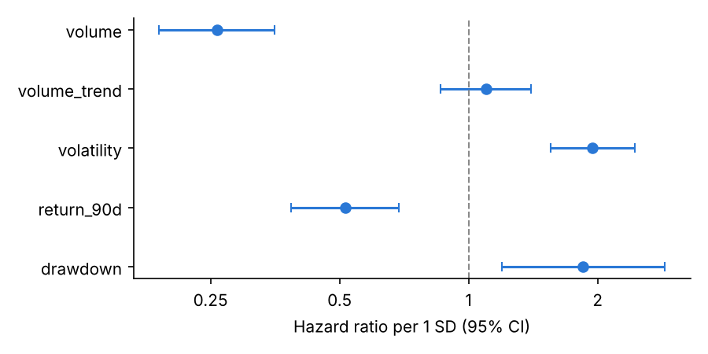
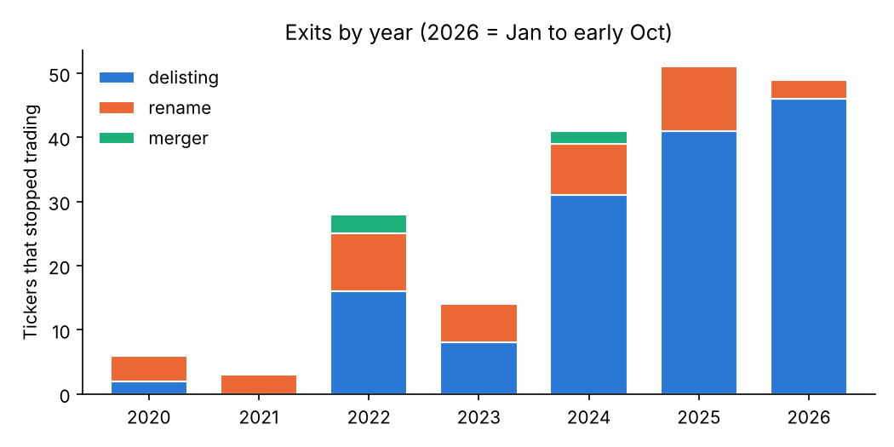
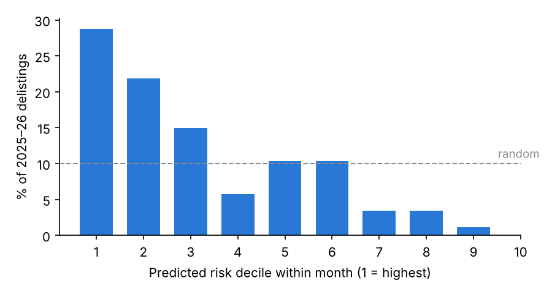

# Which Binance Tokens Get Delisted? A Survival Analysis

A point-in-time database of every Binance USDT spot token from 2020 to October 2026, and a time-varying Cox model
of which tokens Binance announces it will delist. The database is built in SQL (DuckDB); the model uses `lifelines`.

## Main findings

| | Result |
|---|---|
| Data | 587 tickers chained into 544 assets; 25,049 token-months; 136 delisting announcements |
| Labels | 192 tickers stopped trading: 144 delistings (8 of them only the USDT pair), 43 renames, 5 mergers, labeled by hand with sources |
| Strongest signal | 1 SD more trading volume → delisting hazard × **0.26** (95% CI 0.19–0.35) |
| Event | The month Binance announces the delisting (median 14 days before trading stops), not the last trading day |
| Age matters | For tokens under 2 years old, trading close to the all-time high raises the hazard (HR 3.62 per SD of drawdown, where drawdown = price / running max − 1); for older tokens, high volatility does (HR 2.10) |
| Out of sample | Walk-forward, refit yearly: AUC **0.74** in 2025 and **0.73** in 2026, vs 0.69 and 0.73 for volume alone; the age terms lift 2026 to **0.79**, though the pre-2026 data back them only weakly; with them, each month's riskiest 10% of tokens contains 38% of the 2025–26 delisting announcements |



## Pipeline

```
load_db.py                 builds crypto.duckdb and fails if any integrity check fails
labels/exit_labels.csv     192 exits: delisting / rename / merger, scope, successor, swap ratio, announcement date, source URL
sql/01_daily.sql           trailing features per token-day (30/90/180-day windows, drawdown)
sql/02_lifetimes.sql       one row per ticker: first/last trade, exit type and date, asset_id, left truncation
sql/03_panel.sql           token-month panel with start/stop intervals and features as of each cutoff
survival_analysis.ipynb    data checks, Cox model, proportional hazards, robustness, bootstrap, out-of-sample test
```

```bash
python dataclean.py            # from the repository root; writes data/close_clean.csv, data/volume_clean.csv
python delisting/load_db.py
cd delisting && jupyter nbconvert --to notebook --execute --inplace survival_analysis.ipynb
```

## Design choices

**Delisting vs rename.** A ticker that stops trading is often not a failure: MATIC became POL, FTM became S.
Renames are chained into one asset, and age keeps counting across the rename. Features are computed per asset, not per
ticker, with prices adjusted by the swap ratio like a stock split (1 NPXS became 0.001 PUNDIX), so a rename does not
reset the 180-day windows or the all-time high. Mergers are censored. Only token-level
delistings are events; the 8 cases where Binance removed only the USDT pair are tested as a robustness check.

**No look-ahead.** Every feature window looks backward, and an `ASOF JOIN … ON cutoff > ts` takes the last trading day
strictly before each cutoff. The notebook recomputes 800 values from raw prices in pandas: 0 mismatches.

**Event = announcement.** Binance announces a delisting a median 14 days (at most 15) before trading stops, and the
price moves on the notice, so the event is the announcement month and the asset leaves the risk set there. 41 of the 144
dated notices fell in the calendar month before the last trading day. If trading stopped before the notice
(MCO, and HC, whose USDT pair was removed first), the asset exits at the last trading day.

**Lagged features.** Delisted tokens trade a median 1.51× more in their last 30 days than in the 60 days before.
The model uses features from 30 days before each month starts, well before any notice.



## Model checks

- **Proportional hazards.** Interacting every feature with log(age) finds that the effects of volatility and drawdown change
  with age (LR test p = 0.0009), so the main model lets them differ for tokens under 2 years old. The pattern holds with a 3-year cutoff.
- **Robustness.** Hazard ratios keep their sign and rough size when USDT-pair removals are added as events, uncertain labels are dropped,
  left-truncated tokens are dropped, or unlagged features are used (`results_robustness.csv`). Volume trend is the exception:
  HR 1.27 (p = 0.03) when the event was the last trading month, 1.05 (0.82–1.35) with the announcement month, so it is not a reliable signal.
- **Batch announcements.** Binance delists in batches (up to 18 tokens in a month), so the model's standard errors are
  too small. A cluster bootstrap that resamples whole calendar months (500 draws) widens the intervals but changes no
  conclusion: volume 0.19–0.39, volatility for older tokens 1.42–2.77, drawdown for young tokens 1.82–7.84, and the
  90-day return, the closest call, 0.31–0.92 (`results_bootstrap.csv`).
- **Out of sample.** Walk-forward validation with an expanding window, refit once a year: 2025 is scored by a model fit on
  2020–24 (49 delistings), 2026 by a model refit on 2020–25 (90 delistings). The age terms were found on the full sample,
  so each fold adds them only if its own proportional hazards test rejects. Before 2025 it finds nothing (p = 0.83);
  before 2026 it rejects (p = 0.045), and the 2026 AUC rises from 0.733 to 0.792 (+0.06, paired bootstrap over months
  0.04–0.09). The support is thin: before 2026 only volatility's age term is significant on its own (drawdown's has
  p = 0.18), and most of the 2026 gain comes from the drawdown term.



## Limitations

- The out-of-sample test has only 87 delistings over 22 months, so its AUCs are noisy.
- 136 events is a small sample, and only 17 delisted tokens were under two years old.
- Age is observed age: for tokens already trading when the data starts, it counts from the first day in the data.
- Tokens Binance had removed before the data was pulled are missing, so early years undercount delistings.
- Only USDT pairs on Binance spot are covered. 21 rename labels have no source link.
